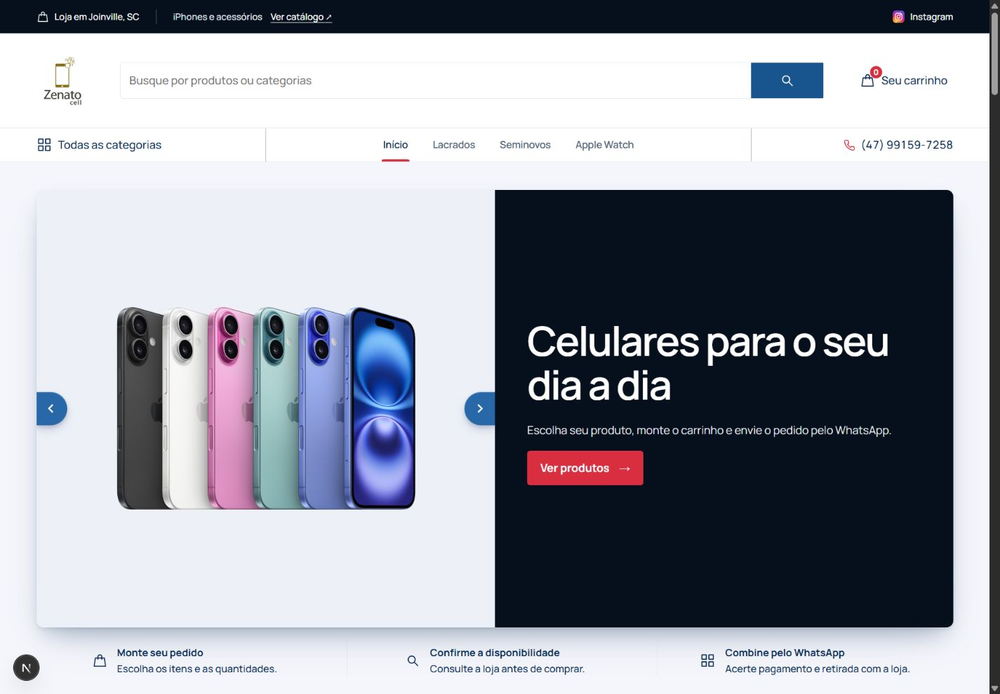
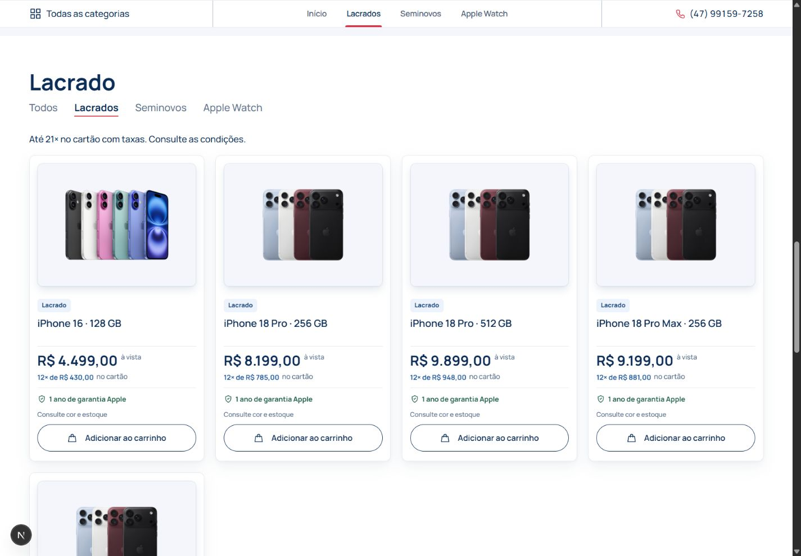
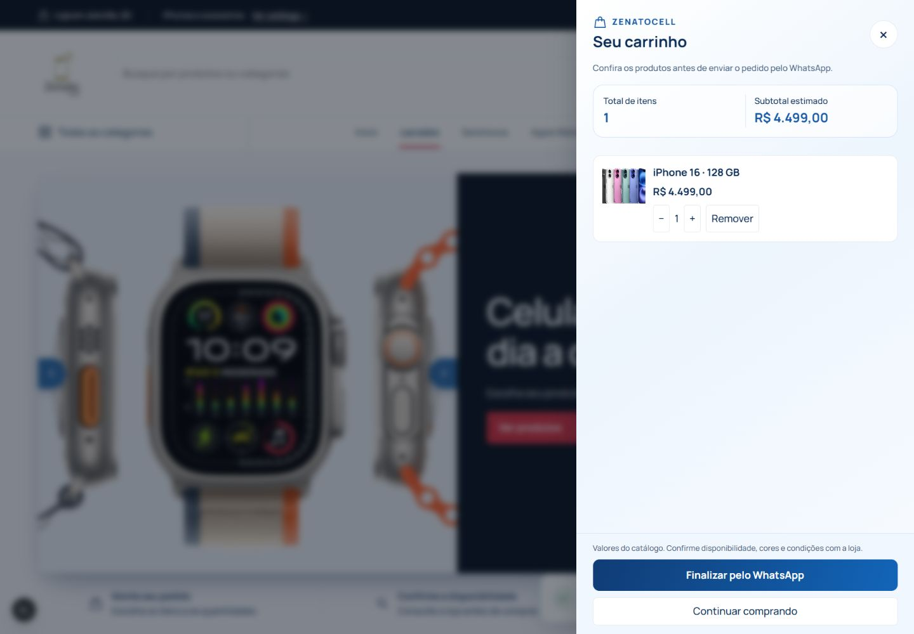
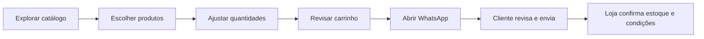
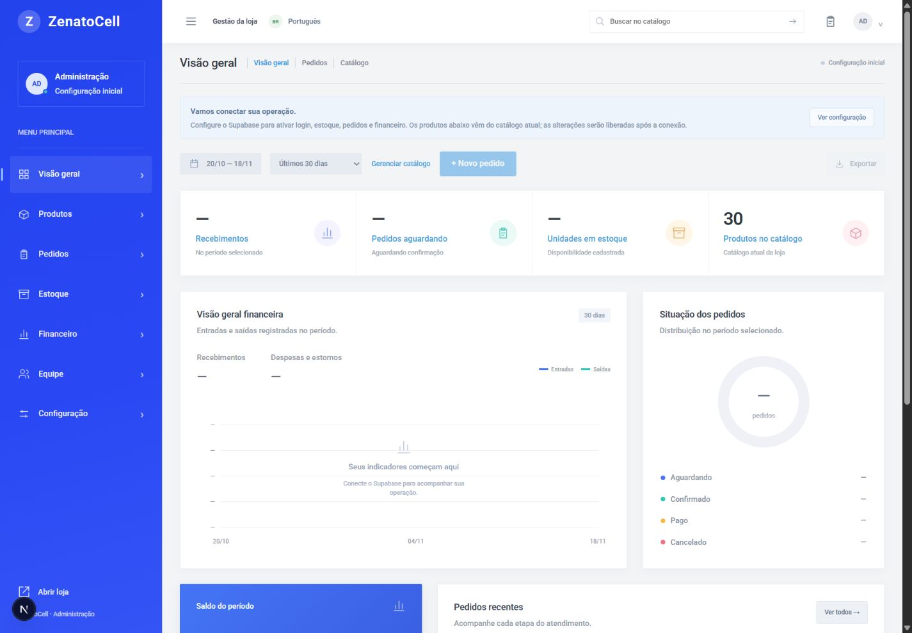

<div align="center">



<br>

**iPhones lacrados · Seminovos · Apple Watch**

Catálogo responsivo com preços, parcelamento e carrinho integrado ao WhatsApp.

[Instagram](https://www.instagram.com/zenatocell/) · [Desenvolvedor](https://brunomarianosilva.com.br/) · [Catálogo original](https://zenatocell.my.canva.site/lista-iphones-lacrados)

</div>

## O projeto

A ZenatoCell reúne os produtos da loja em uma única página. O visitante pesquisa modelos, filtra por condição, consulta fotos e parcelas, monta uma seleção e abre o WhatsApp com o pedido organizado.

O projeto utiliza Next.js, React e TypeScript. Os dados do catálogo ficam separados dos componentes para facilitar atualizações e a integração com o painel administrativo.

## Recursos implementados

| Experiência    | Funcionamento                                                                           |
| -------------- | --------------------------------------------------------------------------------------- |
| Catálogo       | 30 variantes cadastradas, separadas em lacrados, seminovos e Apple Watch                |
| Busca          | Pesquisa por nome e categoria, desconsiderando acentos                                  |
| Filtros        | Navegação por categoria com transição em navegadores compatíveis                        |
| Fotos          | Imagens dos catálogos da loja; carrossel nos produtos com fotos distintas               |
| Hero           | Troca de imagens por setas, arraste ou avanço automático                                |
| Carrinho       | Adição no card, controles de quantidade, remoção e subtotal                             |
| WhatsApp       | Mensagem com modelos, capacidades, condições, quantidades e subtotal estimado           |
| Privacidade    | Preferência de persistência do carrinho e painéis de políticas                          |
| Avaliações     | Relatos selecionados, fotos públicas, nota informada e link para o Google               |
| Contato        | Instagram, telefone clicável e rota para o endereço da loja                             |
| Acessibilidade | Links de salto, controles identificados, foco visível e respeito à redução de movimento |
| Layout         | Grade responsiva e controles de compra adaptados a telas estreitas                      |

## A loja em funcionamento

Capturas reais da aplicação local. Desktop em 1440 × 1000 px e mobile em 390 × 844 px.

### Catálogo e condições de pagamento



### Carrinho no desktop



### Experiência no celular

<table>
<tr>
<td align="center" width="50%"><strong>Home mobile</strong><br><br></td>
<td align="center" width="50%"><strong>Pedido no carrinho</strong><br><br></td>
</tr>
</table>

O carrinho apresentado contém um iPhone 16 de 128 GB, com subtotal de R$ 4.499,00. A captura mostra o pedido antes do envio pelo visitante.

## Jornada do pedido



O envio da mensagem depende da ação do visitante no WhatsApp. A confirmação da venda, o recebimento do pagamento e a baixa de estoque ainda são realizados pela loja fora deste sistema.

## Executar localmente

Use **Node.js 22** e npm.

```bash
npm ci
npm run dev
```

Acesse [localhost:3000](http://localhost:3000).

| Comando             | Finalidade                                          |
| ------------------- | --------------------------------------------------- |
| `npm run dev`       | Servidor de desenvolvimento                         |
| `npm run typecheck` | Geração dos tipos de rotas e verificação TypeScript |
| `npm run build`     | Build de produção                                   |
| `npm start`         | Servidor a partir do build                          |

A versão atual utiliza dados estáticos e dispensa credenciais de banco de dados.

## Estrutura do código

```text
src/
├── app/
│   ├── layout.tsx
│   └── page.tsx
├── components/
│   ├── cart/
│   │   └── CartDrawer.tsx
│   ├── catalog/
│   │   ├── ProductCard.tsx
│   │   └── ProductPhotos.tsx
│   ├── privacy/
│   │   └── PrivacyControls.tsx
│   ├── storefront/
│   │   ├── CustomerReviews.tsx
│   │   ├── Hero.tsx
│   │   ├── SiteFooter.tsx
│   │   ├── SiteHeader.tsx
│   │   └── Storefront.tsx
│   └── ui/
│       └── Icons.tsx
├── config/
│   └── store.ts
├── data/
│   ├── catalog.ts
│   └── reviews.ts
├── lib/
│   └── format.ts
└── styles/
    └── store.css
public/
└── zenatocell/
docs/
└── screenshots/
```

## Atualizações e manutenção

| Alteração                                       | Arquivo                                      |
| ----------------------------------------------- | -------------------------------------------- |
| Modelos, capacidades, fotos, valores e parcelas | `src/data/catalog.ts`                        |
| Telefone, Instagram e links externos            | `src/config/store.ts`                        |
| Relatos selecionados                            | `src/data/reviews.ts`                        |
| Navegação                                       | `src/components/storefront/SiteHeader.tsx`   |
| Banner principal                                | `src/components/storefront/Hero.tsx`         |
| Apresentação do produto                         | `src/components/catalog/ProductCard.tsx`     |
| Navegação das fotos                             | `src/components/catalog/ProductPhotos.tsx`   |
| Carrinho lateral                                | `src/components/cart/CartDrawer.tsx`         |
| Políticas e preferências                        | `src/components/privacy/PrivacyControls.tsx` |
| Cores, espaçamentos e responsividade            | `src/styles/store.css`                       |

### Dados comerciais

- Preços e parcelas são armazenados como **inteiros em centavos**.
- Cada capacidade ou tamanho possui um identificador próprio.
- Um valor `null` representa informação pendente de confirmação e exibe consulta de preço.
- Parcelas seguem os valores publicados pelo catálogo, inclusive quando o total parcelado difere do preço à vista.
- Cor e disponibilidade são confirmadas com a loja.
- O Series 9 de 45 mm está sob consulta devido à inconsistência do preço na origem.
- O número de WhatsApp configurado atualmente é **(47) 99159-7258**, conforme solicitado durante o desenvolvimento.

### Privacidade

A seleção funciona durante a visita. Quando o visitante autoriza, o carrinho é salvo no armazenamento local para futuras visitas. As preferências podem ser alteradas no rodapé.

O site carrega recursos externos de fotos e fontes. Os textos das políticas precisam acompanhar as práticas reais da empresa e os serviços que forem adicionados.

## Fontes do catálogo

- [iPhones seminovos](https://zenatocell.my.canva.site/catalogo-iphones-seminovos)
- [iPhones lacrados](https://zenatocell.my.canva.site/lista-iphones-lacrados)
- [Apple Watch](https://zenatocell.my.canva.site/apple-watch)
- [Listagem pública das avaliações](https://consertabrasil.com/conserto-de-celulares/joinville/zenato-cell-vendas-e-assistencia-tecnica-de-celulares/)

A nota e o volume exibidos foram extraídos de uma listagem pública que reproduz avaliações do Google. Os relatos são resumos. As informações precisam ser conferidas periodicamente com a origem.

## Publicação

O repositório inclui `vercel.json` configurado para Next.js.

- Instalação — `npm ci`
- Build — `npm run build`
- Versão do Node.js — `22.x`
- Rota pública — `/`

A publicação de um commit no GitHub pode iniciar o deploy se o repositório estiver conectado a um projeto Vercel. O envio ao GitHub, isoladamente, não confirma o estado do deploy.

## Painel administrativo



Acesse **/admin** para gerenciar a operação. O visual segue a composição do Star Admin: lateral azul recolhível, fonte Roboto, barra superior clara, indicadores, gráfico financeiro e distribuição dos pedidos. O painel inclui filtro de período e exportação CSV dos lançamentos para gestores conectados. A interface adapta o catálogo para cards no mobile e mantém a navegação acessível em tablets.

| Área       | Recursos implementados                                                        |
| ---------- | ----------------------------------------------------------------------------- |
| Produtos   | Cadastro, edição, preço, custo, parcelamento, garantia e publicação           |
| Fotos      | Upload para Storage, inclusão e remoção de referências                        |
| Pedidos    | Vários produtos, conferência dos itens, confirmação, pagamento e cancelamento |
| Estoque    | Entradas, saídas, validação de disponibilidade e histórico                    |
| Financeiro | Recebimentos, despesas, estornos e saldo dos lançamentos                      |
| Equipe     | Proprietário, funcionário e superadmin, com suspensão de acesso               |

**Integração:** Supabase fornece autenticação, persistência e armazenamento. Novas instalações devem seguir o guia de administração e executar as migrações antes do primeiro acesso.

Consulte o [guia completo de instalação e operação](docs/admin.md). As migrações ficam em `supabase/migrations` e o catálogo inicial em `supabase/seed.sql`. Enviar um pedido ao WhatsApp não confirma a venda nem baixa o estoque: a loja confirma pelo painel depois do atendimento.

`npm run test:db` executa 67 verificações em PostgreSQL isolado: acesso público, permissões, suspensão, estoque insuficiente, confirmação repetida, recebimento e cancelamento com estorno. Não exige credenciais ou acesso ao Supabase de produção.

## Verificações

A reorganização passou na verificação TypeScript e no build de produção. Para as capturas, foram conferidos a home desktop, o filtro de lacrados, a adição de um item, o subtotal e o link gerado para o WhatsApp. A home e o carrinho também foram abertos em 390 px. O teste não enviou mensagens nem substitui a revisão de todos os produtos e breakpoints.

---

Desenvolvido por **[Bruno Mariano](https://brunomarianosilva.com.br/)**.

A marca, os dados e as imagens da loja são usados neste projeto para a apresentação da ZenatoCell.

### Acesso e identidade visual


O login tem composição editorial, fotografia exclusiva em WebP e adaptação para desktop, tablet e celular. Gestores podem atualizar nome e logo em **Configuração → Identidade da loja**. A identidade é compartilhada entre o login e o menu administrativo, com permissões verificadas no banco.

A migração `002_branding.sql` acrescenta essa configuração. Os 67 testes isolados incluem leitura pública da identidade, restrição de uploads e bloqueio de alterações por visitantes e funcionários.

Validação funcional: veja [o relatório de homologação](docs/admin-validation.md), com casos exercitados, correções e itens ainda dependentes de teste integrado no ambiente hospedado.
